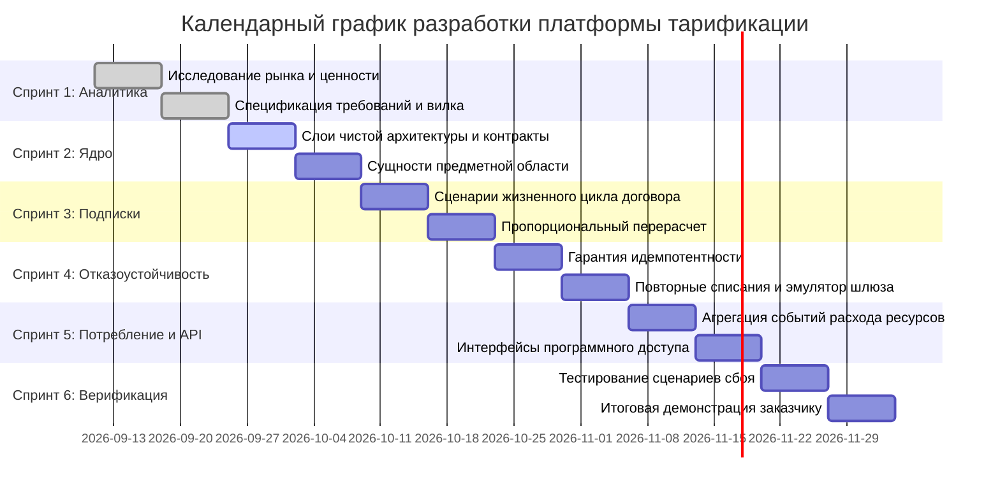

# Календарный план разработки и диаграмма Ганта

## 1. Структура спринтов и распределение работ

Проект разделен на 6 последовательных спринтов продолжительностью по 2 недели каждый, покрывающих полный цикл от аналитики до итоговой защиты работающего прототипа с доказательством отказоустойчивости.

| Спринт | Период | Название спринта | Основные цели и артефакты | Оценка (SP) |
| :--- | :--- | :--- | :--- | :---: |
| **Спринт 1** | Недели 1–2 | Аналитика и формализация требований | Первичный ресерч, бенчмаркинг аналогов, User Stories, спецификация функциональных и нефункциональных требований (FR/NFR), калибровка вилки сложности. | 21 |
| **Спринт 2** | Недели 3–4 | Архитектурный базис ядра | Проектирование слоев чистой архитектуры на Python. Доменные сущности (арендатор, тариф, подписка, платежное требование), инварианты предметной области, базовые контракты репозиториев. | 34 |
| **Спринт 3** | Недели 5–6 | Жизненный цикл подписок и перерасчет | Сценарии оформления подписок, переходы между состояниями, механизм пропорционального перерасчета стоимости при смене тарифа в середине периода. | 40 |
| **Спринт 4** | Недели 7–8 | Идемпотентность и обработка сбоев | Реализация механизма ключей идемпотентности, обработка сценариев отказа платежных каналов, модуль повторных списаний с нарастающей задержкой, эмулятор шлюза со сбоями. | 34 |
| **Спринт 5** | Недели 9–10 | Учет фактического потребления и API | Модуль приема и агрегации потоковых событий расхода ресурсов, расчет превышения квот, REST API контроллеры для интеграции арендаторов. | 29 |
| **Спринт 6** | Недели 11–12 | Нагрузочные тесты, аудит и демонстрация | Сквозные сценарии тестирования, доказательство отказоустойчивости при моделировании падений шлюзов, итоговая отчетность для заказчика. | 21 |

---

## 2. График реализации (Диаграмма Ганта)

---

## 3. Критерии готовности этапов (Definition of Done)

Каждый спринт завершается выполнением следующих обязательных условий:
1. Код предметной области покрыт модульными тестами, изолированными от баз данных и внешних библиотек.
2. Архитектурные границы соблюдены: зависимости направлены исключительно внутрь (к ядру предметной области).
3. Продемонстрировано сохранение инвариантов системы (невозможность двойного списания, корректность математического перерасчета, изоляция контекстов арендаторов).
4. Обновлен отчет по спринту и подготовлены материалы для обратной связи от заказчика.
